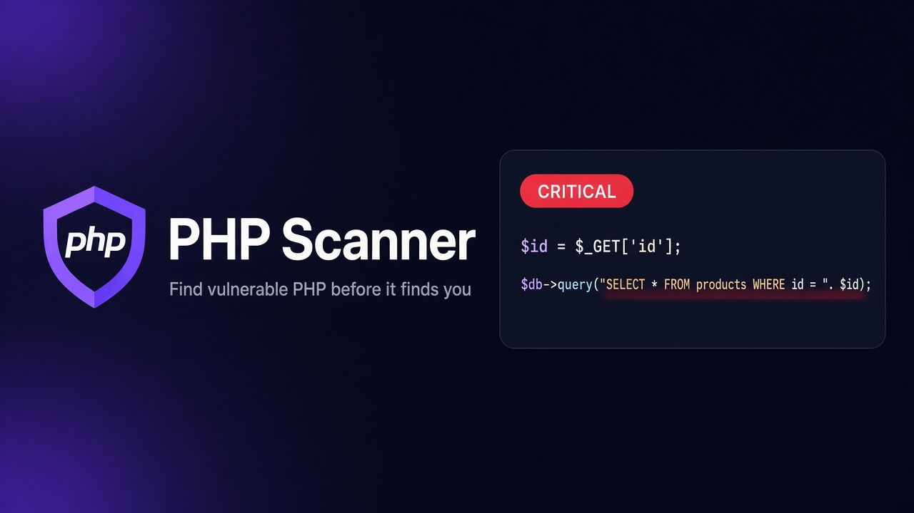

# PHP Scanner

<p align="center">
  
</p>

A free, offline scanner for PHP projects. It reads your source, follows user input into dangerous calls, and tells you whether the PHP runtime itself is exposed to [php2shell](#php2shell-cve-2026-109618--cve-2026-109619). One Rust engine powers a desktop app and a command-line tool for CI.

It is free to use. MIT licensed. Nothing is uploaded.

## What it reads

This is the kind of code it is built for. From [`examples/vulnerable-app`](examples/vulnerable-app/public/index.php):

```php
$id = $_GET['id'];
$result = $db->query("SELECT * FROM products WHERE id = " . $id);

$name = $_POST['name'] ?? '';
echo "<h1>Hello " . $name . "</h1>";

$host = $_GET['host'];
system("ping -c 1 " . $host);

$page = $_GET['page'];
include "pages/" . $page . ".php";
```

`php-scanner scan examples/vulnerable-app` reports that file as SQL injection, cross-site scripting, command injection and local file inclusion, each with the line and the path the input took. The same demo also ships a web shell, a weak `md5()` password hash, a PHP 8.3.30 Docker image, and a `.user.ini` mitigation that PHP says does not work. The scan ends **action required**.

Escaping that actually works is left alone:

```php
$safe = htmlspecialchars($_GET['q'] ?? '', ENT_QUOTES, 'UTF-8');
echo "<p>You searched for {$safe}</p>";
```

| It looks for | Examples |
|---|---|
| Tainted input reaching a sink | SQL, shell, `eval`, `include`, files, SSRF, redirects, headers, LDAP, XPath, regex, `unserialize`, XSS |
| Dangerous APIs and config | Weak hashes and ciphers, `rand()` for secrets, TLS verification off, `==` on tokens, XXE, `display_errors`, `phpinfo()`, `chmod 0777`, `mysql_*` |
| Secrets | AWS, GitHub, Slack, Stripe, Google, OpenAI, private keys, database URLs. Values are masked in every report |
| Malware | Known web shells, `eval($_POST…)`, encoded payloads, PHP dropped in an upload directory |
| php2shell | Runtime pins, ineffective mitigations, local PHP binaries, signs of compromise |

WordPress core, about 2,000 files and 700k lines, scans in about 1.6 seconds. Reports come out as HTML, SARIF 2.1.0, JSON or CSV.

## php2shell (CVE-2026-109618 / CVE-2026-109619)

php2shell is an unauthenticated remote code execution flaw (plus a worker-memory disclosure) **in the PHP interpreter itself**. No application-code change fixes it. The fix is upgrading PHP to **8.5.12, 8.4.27, 8.3.36 or 8.2.35** (or a vendor backport) and **restarting** Apache, PHP-FPM and long-running workers. PHP 8.1 and older receive no official fix.

What the scanner does about it:

| Check | Rule |
|---|---|
| PHP versions declared in `composer.json` (`config.platform.php`), Dockerfiles (`FROM php:…`, `ARG`), compose/K8s/CI `image:`, OS packages, `.php-version`, `.tool-versions` and `app.yaml` | `php2shell-vulnerable-runtime`, `php2shell-unsupported-runtime`, `php2shell-unpinned-runtime` |
| Composer `require.php` constraints that still allow vulnerable versions | `php2shell-composer-constraint` |
| `session.upload_progress.enabled` / `fatal_error_backtraces` (8.5) not disabled in php.ini, FPM pools, Apache/nginx config | `php2shell-mitigation-missing` |
| Mitigations set via `ini_set()`, `.user.ini` or `.htaccess`, which PHP says are ineffective | `php2shell-ineffective-mitigation` |
| `RLIMIT_AS` / `RLIMIT_DATA` (systemd `LimitAS=`/`LimitDATA=`, `ulimit -v/-d`), which PHP warns against | `php2shell-rlimit-misuse` |
| PHP binaries on the scanning machine (`php`, `php8.x`, `php-fpm…`): version and effective ini | `--check-local-runtime`, `php-scanner runtime` |
| Compromise hunting: web shells, backdoors, PHP in upload directories, and integrity verification against a known-good manifest | malware rules, `php-scanner integrity` |
| Secrets that must be rotated because the memory leak can expose them | secret rules |

Each scan ends with a verdict: **Action required**, **Verify production runtimes** (nothing pinned, so a server must be checked by hand), or **Patched in source**. It also prints the advisory's response checklist.

The scanner reads source and configuration. It cannot see the PHP build that is actually running on a server you didn't scan, so always confirm with `php -v` / `php-fpm -v` on each host.

The advisory data lives in [`crates/php-scanner-core/advisories/advisories.json`](crates/php-scanner-core/advisories/advisories.json). To use updated data without rebuilding, pass `--advisory-db file.json` or set `PHP_SCANNER_ADVISORY_DB`.

## Desktop app

```bash
npm ci
npm run app:dev      # development, hot reload
npm run app:build    # installers in target/release/bundle (deb/rpm/AppImage, dmg, msi/nsis)
```

Linux needs `libwebkit2gtk-4.1-dev libappindicator3-dev librsvg2-dev patchelf`. See the [Tauri prerequisites](https://v2.tauri.app/start/prerequisites/).

The app has these screens:

- **Scan**: pick a folder and optional baseline, with live progress and cancel.
- **Overview**: severity and category breakdown, the php2shell verdict, exports, and baseline writing.
- **Findings**: filterable list with code context, the full file, data flow and fixes.
- **php2shell**: runtime inventory, probing local PHP, mitigations, the checklist and sources.
- **Integrity**: create and verify snapshots.
- **Rules**: enable or disable rules.
- **Settings**.

## CLI

```bash
cargo build --release -p php-scanner-cli   # target/release/php-scanner

php-scanner scan ./my-app                          # coloured text report, exit 1 on high+
php-scanner scan . -f sarif -o php-scanner.sarif   # GitHub code scanning
php-scanner scan . -f html -o report.html --fail-on critical
php-scanner scan . --baseline .php-scanner-baseline.json
php-scanner scan . --write-baseline .php-scanner-baseline.json --fail-on none
php-scanner php2shell /var/www                     # focused advisory check + local PHP probe
php-scanner runtime                                # PHP binaries on this host
php-scanner integrity snapshot /var/www -o known-good.json
php-scanner integrity verify /var/www known-good.json
php-scanner rules                                  # every rule with severity and CWE
php-scanner advisories                             # bundled advisory database
```

Exit codes: `0` clean, `1` findings at or above `--fail-on` (or php2shell action required), `2` error.

The same command against the demo:

```bash
php-scanner scan examples/vulnerable-app
```

### GitHub Actions

```yaml
- run: php-scanner scan . --format sarif --output php-scanner.sarif --fail-on none
- uses: github/codeql-action/upload-sarif@v3
  with: { sarif_file: php-scanner.sarif, category: php-scanner }
- run: php-scanner php2shell . --no-local-runtime
```

## Suppressions and baselines

```php
$rows = $db->query($sql); // php-scanner-ignore: sql-injection
// php-scanner-ignore            (on its own line: suppresses the next line, all rules)
// php-scanner-ignore-file       (anywhere in the file)
```

A baseline stores finding fingerprints, which stay stable across line shifts, so CI only fails on **new** issues.

## Architecture

```
crates/php-scanner-core   engine: tree-sitter-php parser, taint analyzer, pattern detectors,
                          advisory checks, integrity, discovery, reports (lib)
crates/php-scanner-cli    `php-scanner` binary (clap)
src-tauri                 desktop shell: Tauri commands around the core
src                       React UI
```

Files are scanned in parallel (rayon). `vendor/` and `node_modules/` are skipped by default, and `.gitignore` is honoured.

## Limitations

- Taint tracking stays within one file. Data passed through other files, sessions or databases isn't followed, and `$_SESSION` isn't treated as a source.
- Like any static analyzer, it reports what it can prove from source. Review findings before acting on them, and don't treat a clean report as proof of security.

## Development

```bash
cargo fmt --all && cargo clippy --workspace --all-targets -- -D warnings
cargo test --workspace
npm run build
```

License: MIT
